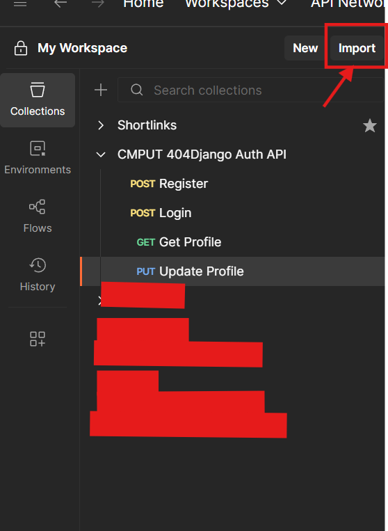
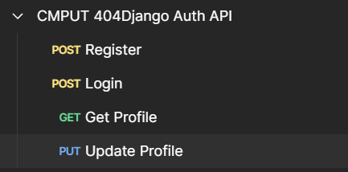
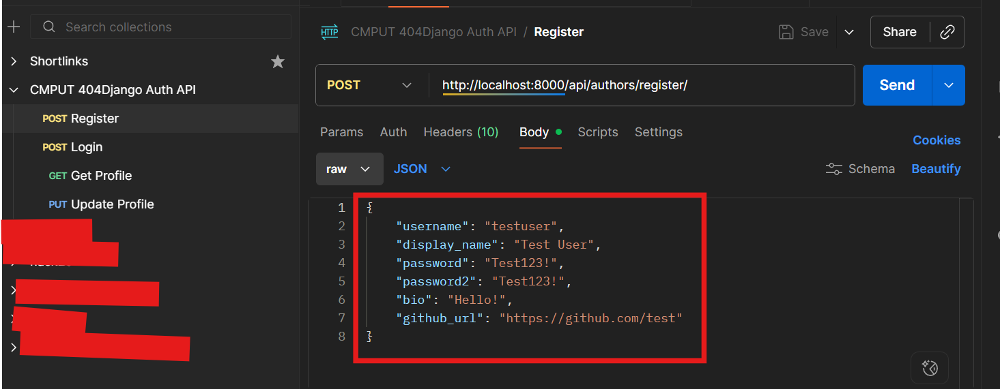
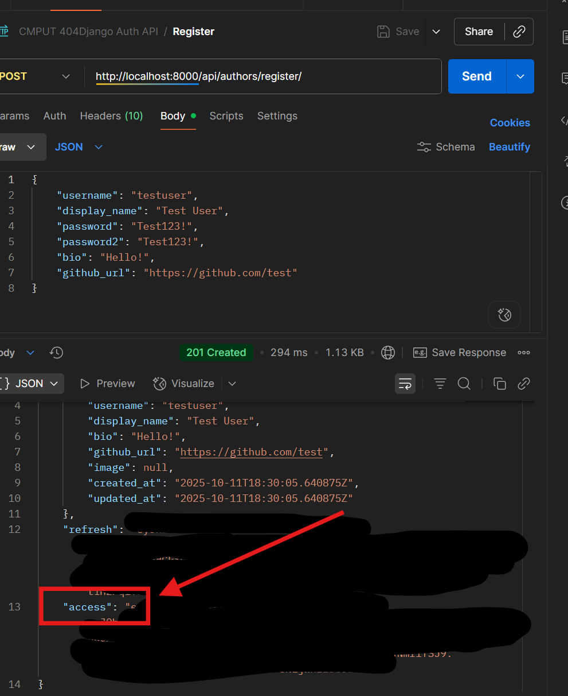
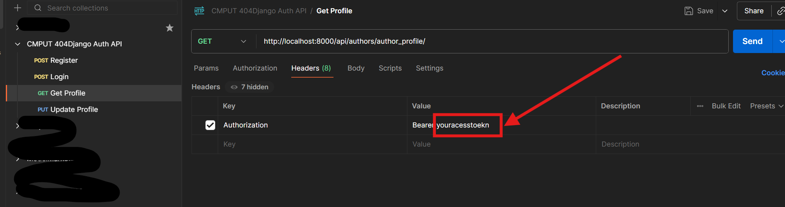

1. Start a virtual environment:

```
python -m venv venv
```

Activate virtual env:
Window:

```
.\venv\Scripts\Activate.ps1
```

CMD:

```
venv\Scripts\activate.bat
```

2. Django:

```
pip install -r requirements.txt
```

3. Run server:

```
python manage.py runserver
```

Run the following commands if asked only
```
python manage.py makemigrations
```

4. Run migrate:
```
python manage.py migrate
```

5. How to register/ login
   Import the following Postman Collection and change the user name/ password

```
{
	"info": {
		"_postman_id": "0345f6c4-f681-49c1-9c4a-54d28c8e2832",
		"name": "CMPUT 404Django Auth API",
		"schema": "https://schema.getpostman.com/json/collection/v2.1.0/collection.json",
		"_exporter_id": "27482618"
	},
	"item": [
		{
			"name": "Register",
			"request": {
				"method": "POST",
				"header": [
					{
						"key": "Content-Type",
						"value": "application/json"
					}
				],
				"body": {
					"mode": "raw",
					"raw": "{\n    \"username\": \"testuser\",\n    \"display_name\": \"Test User\",\n    \"password\": \"Test123!\",\n    \"password2\": \"Test123!\",\n    \"bio\": \"Hello!\",\n    \"github_url\": \"https://github.com/test\"\n}"
				},
				"url": {
					"raw": "http://http://127.0.0.1:8000/api/authors/register/",
					"protocol": "http",
					"host": [
						"localhost"
					],
					"port": "8000",
					"path": [
						"api",
						"authors",
						"register",
						""
					]
				}
			},
			"response": []
		},
		{
			"name": "Login",
			"request": {
				"method": "POST",
				"header": [
					{
						"key": "Content-Type",
						"value": "application/json"
					}
				],
				"body": {
					"mode": "raw",
					"raw": "{\n    \"username\": \"testuser\",\n    \"password\": \"Test123!\"\n}"
				},
				"url": {
					"raw": "http://http://127.0.0.1:8000/api/authors/login/",
					"protocol": "http",
					"host": [
						"localhost"
					],
					"port": "8000",
					"path": [
						"api",
						"authors",
						"login",
						""
					]
				}
			},
			"response": []
		},
		{
			"name": "Get Profile",
			"request": {
				"method": "GET",
				"header": [
					{
						"key": "Authorization",
						"value": "Bearer {{access_token}}"
					}
				],
				"url": {
					"raw": "http://http://127.0.0.1:8000/api/authors/profile/",
					"protocol": "http",
					"host": [
						"localhost"
					],
					"port": "8000",
					"path": [
						"api",
						"authors",
						"profile",
						""
					]
				}
			},
			"response": []
		},
		{
			"name": "Update Profile",
			"request": {
				"method": "PUT",
				"header": [
					{
						"key": "Authorization",
						"value": "Bearer {{access_token}}"
					},
					{
						"key": "Content-Type",
						"value": "application/json"
					}
				],
				"body": {
					"mode": "raw",
					"raw": "{\n    \"display_name\": \"Updated Name\",\n    \"bio\": \"New bio!\"\n}"
				},
				"url": {
					"raw": "http://http://127.0.0.1:8000/api/authors/profile/",
					"protocol": "http",
					"host": [
						"localhost"
					],
					"port": "8000",
					"path": [
						"api",
						"authors",
						"profile",
						""
					]
				}
			},
			"response": []
		}
	]
}
```

For postman:

1. Log in so we can import json
2. 
3. Copy and Paste the collection above , you should see a new collection called "CMPUT404 Django Auth API"
   
4. Update information when you register
   

5. After sending the request, you will receive refresh and access token, use the access token for the other calls
   
   
