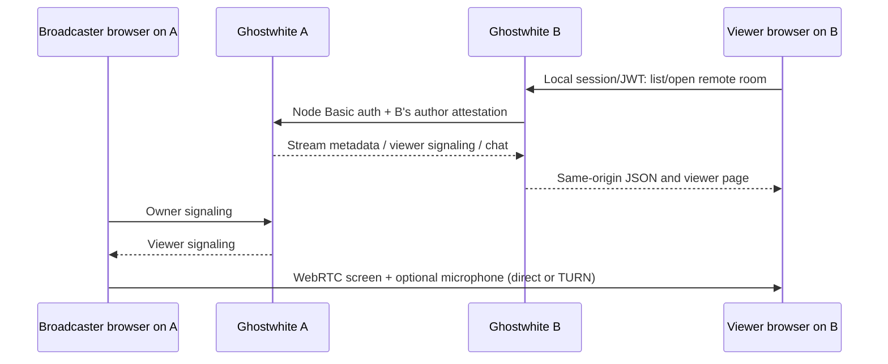

# Watching streams across connected nodes

[Documentation index](README.md)


Ghostwhite now provides a streaming extension to its node protocol. Two updated
Ghostwhite instances can discover each other's open rooms, watch from their
own domain, and exchange chat. A different application must implement the
contract below; ordinary post/follow federation alone does not add playback.



The viewer needs an approved active account on B, not a login on A. The host
keeps broadcasting on A. Each browser talks to its own origin for API requests;
neither node passwords nor foreign session/JWT tokens enter the other browser.
Only the existing local owner can start/end a room or send offers.

## Configure both nodes

1. Update both checkouts and install their existing requirements/Node lockfile.
   Run `python manage.py migrate` and `python manage.py collectstatic --noinput`.
   Migration `streams/0004_streampeer` adds viewer mailbox ownership; no existing
   stream records change. This is a local setup instruction, not a deployment.
2. In each node's existing admin, configure exactly one local Node. Its
   `host_url` is the canonical external origin, including any base path and
   trailing slash, e.g. `https://a.example/`. This must match local author FQIDs.
   Use distinct, nonempty, private node usernames/passwords for A and B.
3. Register A as a remote Node on B using A's canonical URL and A's node
   credentials. Register B on A using B's URL and B's credentials. Both remote
   records must have `is_active=True`, `is_disabled=False`, `is_local=False`.
   Outbound calls use the sending node's **local** credentials, matching the
   existing inbox federation convention. Never put these credentials in JS.
4. Production node URLs must use HTTPS (`DJANGO_DEBUG=0` refuses HTTP proxy
   destinations). Use the actual hosts in `DJANGO_ALLOWED_HOSTS`. Loopback
   HTTP is supported only for local development with DEBUG enabled.
5. On A, create a room and start screen sharing. On B, sign in and open
   `/streams/`; its connected-node sections load independently. Open A's room.
   The URL remains on B: `/streams/remote/<node-id>/<stream-serial>/`.

The originating server owns stream state; remote rooms are not copied into B's
Stream table. Disconnected/unsupported nodes have explicit error/retry feedback.
An open room is not proof that its owner is currently sharing; player state
still distinguishes waiting, connecting, live, error and ended.

## Media connectivity and TURN

The default public STUN server can discover candidates but cannot guarantee
connectivity across restrictive NATs/firewalls. For reliable cross-network
delivery, configure an operator-owned TURN service. No service is provisioned
or paid for by this feature. Both nodes should provide suitable ICE servers.

Supported environment settings:

```text
STREAM_ICE_SERVERS_JSON=[{"urls":"stun:stun.example.net:3478"}]
STREAM_TURN_URLS=turn:turn.example.net:3478?transport=udp,turns:turn.example.net:5349?transport=tcp
STREAM_TURN_SHARED_SECRET=<the TURN REST secret configured on your TURN server>
```

`STREAM_ICE_SERVERS_JSON` is a standard RTCIceServer array. The optional TURN
REST shared secret stays on the server. It generates username/credential pairs
valid for one hour using the TURN REST HMAC-SHA1 convention. Browser-visible
temporary credentials are necessary for TURN authentication. The authenticated
same-origin `GET /api/streams/ice/` refreshes them with `Cache-Control: no-store`.
New connections refresh stale page credentials. Each side schedules renewal
from its own credential expiry: the host sends a peer-specific bye, or the
viewer rejoins, whichever is due first. This may briefly interrupt playback and does
not turn on a previously disabled microphone. These paths have simulated
lifecycle coverage; real TURN allocation/renewal needs operator validation.

HTTPS, reachable HTTPS APIs, configured TURN ports and browser media support
are separate requirements. Node API connectivity alone cannot prove delivery.
The existing P2P model remains intended for a handful of viewers, not large
broadcast audiences.

## Third-party server contract: version 1

All endpoints are under the **stream host**'s `/api/federation/streams/`.
HTTPS requests require:

```http
Authorization: Basic <base64(remote-node-username:remote-node-password)>
X-Stream-Author: https://viewer-node.example/api/authors/<author-id>
X-Stream-Display-Name: <optional percent-encoded UTF-8 display name>
Accept: application/json
Content-Type: application/json
```

The authenticated node is trusted to attest its own logged-in authors only.
`X-Stream-Author` must start with that node's exact configured `host_url` plus
`api/authors/`; the final ID contains only letters, digits, `_`, `-`.
Maximum FQID length is 150 characters; display name maximum is 255. A node
cannot attest a host-local author or an author attached to another node.
Mirrors have unusable passwords and do not grant local login, staff or owner
privileges. The first attested display name is retained; this endpoint is not
a profile-update protocol.

| Method and suffix | Behavior |
| --- | --- |
| `GET /` | `{"type":"streams","items":[...]}`; at most 100 newest open rooms owned by this node |
| `GET /<serial>/` | Stream metadata, including ended rooms |
| `POST /<serial>/signals/` | Viewer `join`, `answer`, `candidate`, or `bye`, always `direction:"to_streamer"` |
| `GET /<serial>/signals/?role=viewer&peer_id=<id>` | Consume signals for this viewer's mailbox |
| `POST /<serial>/bullets/` | `{"content":"message"}`; 1–120 trimmed characters |
| `GET /<serial>/bullets/?latest=1` | Latest 30 messages in ascending ID order |
| `GET /<serial>/bullets/?after=<cursor>` | Up to 50 newer messages; non-consuming |

Metadata follows the local stream JSON shape: `type`, full-FQID `id`, UUID
`serial`, `owner` (including full-FQID `id` and `displayName`), `title`,
`description`, `status` (`live` means open room, or `ended`), `startedAt`,
`endedAt`, `webUrl`. `webUrl` is the host's local-login page; a third-party UI
must use its own authenticated adapter to watch without a host login.

Viewer signal request:

```json
{"kind":"join","direction":"to_streamer","peer_id":"a-random-UUID","payload":{}}
```

A successful POST returns HTTP 201 and
`{"type":"signal","kind":"join","peer_id":"a-random-UUID"}`.
Generate a new unpredictable peer ID per browser connection, at most 64
characters. First viewer use binds it to that author until the room ends;
another author's reads/writes to the same mailbox return 403. Poll results:

```json
{"type":"signals","items":[{"kind":"offer","peer_id":"a-random-UUID","payload":{"type":"offer","sdp":"..."},"sender_serial":"host-id"}]}
```

Accept the host's SDP offer, send an SDP `answer`, and relay ICE `candidate`
objects both ways. Buffer candidates that arrive before the remote description.
Signal payloads are limited to 32 KiB. Poll consumes messages; do not run two
consumers against one mailbox. Send periodic `join` while waiting; use a fresh
peer ID when reconnecting. A host `bye` ends that connection, not necessarily
the room. Host-local owner signaling remains `/api/streams/<serial>/signals/`.

The SDP includes video plus reserved microphone audio. Commentary is opt-in;
mute disables the outgoing microphone track. The host's `commentary` data
channel sends `{"type":"microphone","available":true|false}`. An audio track
alone does not prove that the microphone is enabled. Remote players must
support this channel, preserve viewer-local mute/volume, and handle browser
autoplay rejection with a visible Enable sound action while video continues.
All these behaviors are implemented by the Ghostwhite remote viewer page.

Chat GET returns `{"type":"bullets","items":[...],"cursor":123}`. Each item
has `type:"bullet"`, integer `id`, literal `content`, `sender` with `serial` and
`displayName`, and ISO `created_at`. POST returns that item with HTTP 201.
Render all text literally, preserve ascending IDs, deduplicate overlapping
polls and retain bounded history. IDs/cursors must fit JavaScript safe integers.
Disabling video comments must not disable chat or replay old overlay comments.

401/403 means invalid/revoked node or author access; 404 means unknown room or
unsupported route; 410 means ended room. Stop polling/media on terminal access
failure. The home proxy maps upstream 401/403 to 403 and transport/incompatible
responses to 502. It exposes no create/end/owner route. It ignores browser
supplied author identities and asserts the authenticated home user instead.

## Boundaries and failure behavior

- Proxy URLs derive only from enabled admin-configured nodes and fixed paths.
  Redirects are refused. There is a 1 MiB response cap and typed validation for
  metadata, chat cursors/messages and signal recipients/payloads.
- HTTP timeouts are 3 seconds for connection and 5 seconds of read inactivity.
  These are **not a total wall-clock deadline**: an enabled remote server that
  continually drips bytes can occupy a worker longer. Connect only trusted
  nodes; apply a total outbound deadline at the hosting/network layer if needed.
  No hosting deadline is assumed or configured by this change.
- Disabling a node at the host rejects later federation requests. On its next
  signaling poll, the broadcaster receives `bye` for affected peers and closes
  them. Revoked peer bindings remain until room end so later polls repeat the
  idempotent teardown if a response was lost. The home viewer closes media/chat
  on 401/403/404. Disabling only on the
  home node relies on that home client's terminal-error handling; the host must
  also disable that node to enforce host-side revocation independently.
- CORS and iframe security remain unchanged. This is a server-to-server
  extension, not permission to embed host cookies or node secrets in a page.
- Ending a room purges its signals and peer bindings. Chat history retains its
  existing persistence policy; ended rooms reject further chat/signaling.

## Verification commands

```bash
python manage.py test streams --noinput
node --test streams/js_tests/*.test.cjs
python streams/browser_tests/federation.py --browser
python streams/browser_tests/media.py --capture-only
python streams/browser_tests/media.py --ui-check
```

The federation harness launches two real Django processes, two separate
temporary SQLite databases and two HTTP origins with reciprocal fixture nodes.
It checks discovery both ways, identity/permissions, relay, literal chat,
disable/re-enable, end/cleanup and real browser navigation. It does not contact
any configured production nodes or modify the development database.
Screenshots default to `/tmp/ghostwhite-federation-preview` (override with
`STREAM_FEDERATION_OUTPUT`); they contain synthetic room/account content.

On an approved machine allowing WebRTC, set `CHROMIUM_PATH` if necessary, then:

```bash
python streams/browser_tests/federation.py --media
python streams/browser_tests/media.py
```

`--media` adds native synthetic cross-node audio/video, mute/unmute, muted late
join and stop/restart checks. Do not run it to bypass managed cloud policy.
Then verify two HTTPS deployments on different networks with the configured
TURN service, including >1-hour renewal, host-side node revocation, real
microphone/permissions and audible output. Third-party compatibility requires
running this contract against that implementation. See
[validation](../specs/006-federated-streams/validation.md) for actual results;
none of these manual checks is implied by passing HTTP tests.
